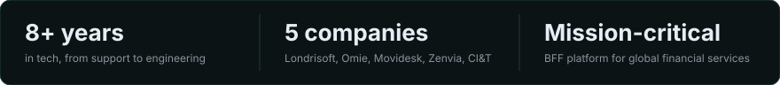
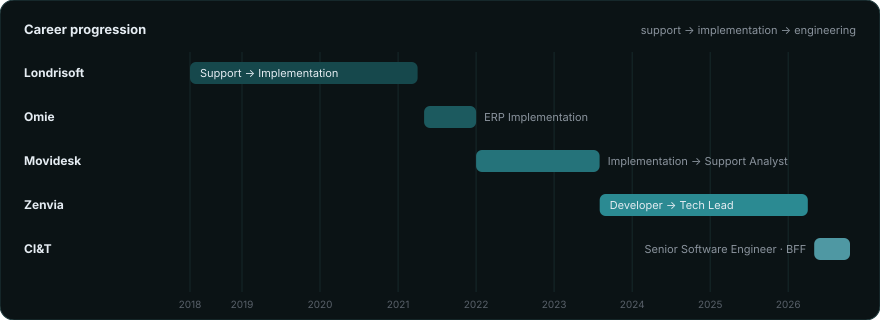
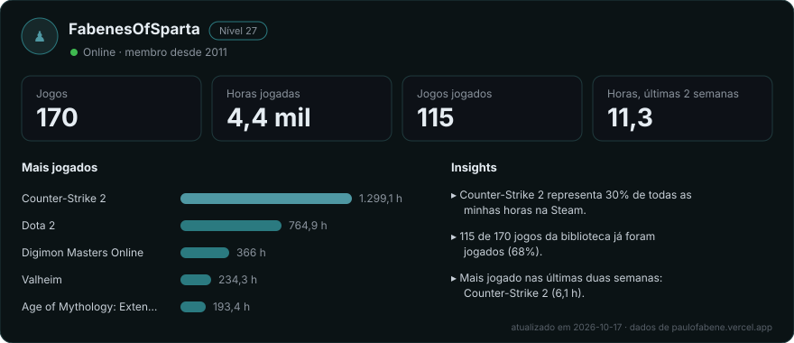

  

  <code>● SENIOR BACK-END DEVELOPER</code>

  I design high-performance BFF architectures, scalable APIs and mission-critical integrations 
  with Node.js, TypeScript and AWS, with 8+ years from support and implementation to software engineering.

  🏢 Currently at <b>CI&T</b> &nbsp;·&nbsp; 📍 Campinas, SP, Brasil

  
  
  
  
  
  

## Featured projects

| Project | What it is | Stack |
|---|---|---|
| **[ChoppNow](https://www.choppnow.com.br)** · in production | Sales booster for draft beer events: a public storefront that generates the order and a console that backs the supplier payout | Next.js · TypeScript · Turborepo · Supabase · PostgreSQL · Upstash Redis · WhatsApp Cloud API · Sentry · Jest · Playwright |
| **[Viking Oarsmen](https://github.com/fabenejr/row-your-boat)** · open source | Valheim mod | C# · .NET Framework · Unity · BepInEx · Jötunn |
| **[CloudWalk Monitoring](https://github.com/fabenejr/cloudwalk-monitoring-test)** · challenge | Real-time monitoring with alerts | Node.js · Express · WebSocket · SQLite · node-cron · Gemini |
| **[NLW SpaceTime](https://github.com/fabenejr/nlw_spacetime)** · study | AI agents with vector search | TypeScript · Fastify · Drizzle ORM · PostgreSQL · pgvector · Zod · React |

## Skills & technologies

| | |
|---|---|
| **Backend** |         |
| **Databases** |      |
| **Cloud & platform** |        |
| **AI & conversational** |      |
| **Frontend** |    |
| **Platform engineering & leadership** |      |

## Experience

## Games

Straight from my Steam profile, refreshed daily by a GitHub Action.

  

