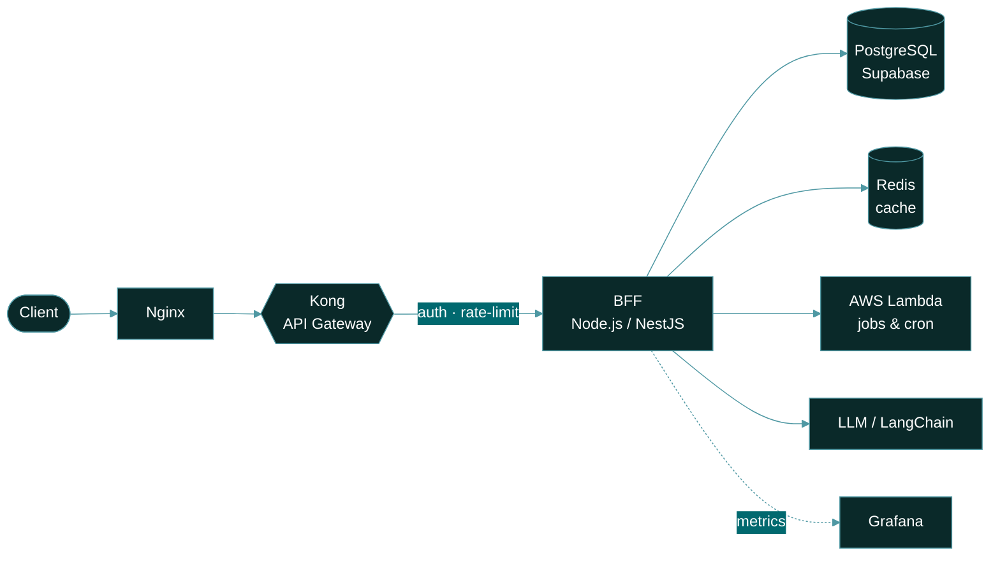

<p align="center">
  
</p>

<p align="center">
  
</p>

<p align="center">
  <a href="https://www.linkedin.com/in/paulofabene"></a>
  <a href="mailto:fabenejunior@hotmail.com"></a>
  <a href="https://instagram.com/paulofabene"></a>
  <a href="https://www.twitch.tv/fabenejr"></a>
</p>

---

### `~/paulo/profile.ts`

```ts
const paulo = {
  role: "Back-End Engineer",
  education: ["Systems Analysis & Development", "ML Engineering"],
  core: ["Node.js", "BFF architecture", "API orchestration"],
  edge: ["Kong", "Nginx", "AWS Lambda"],
  currently: {
    building: "ChoppNow — a sales booster for draft beer events",
    exploring: ["LLM agents", "LangChain", "workflow automation"],
  },
  philosophy: "ship small, observe everything, keep the domain clean",
  status: "always learning, always shipping ✅",
} as const;
```

---

### 🧭 How I like to build: request flow



> Edge handles traffic, the gateway handles policy, the BFF handles orchestration, and the domain stays free of framework code.

---

### 🚀 Featured: ChoppNow

A sales booster for draft beer events: a public storefront that generates the order, plus a lean console that supports the supplier payout.

| | |
|---|---|
| **Architecture** | Monorepo (npm workspaces + Turborepo), ports & adapters, domain with zero framework imports |
| **Stack** | Next.js 16 · TypeScript strict (zero `any`) · Supabase · Tailwind v4 |
| **Money** | Integer cents + `Money` value object, never floats |
| **Orders** | 4 orthogonal state axes: status · payment · validation · fulfillment |
| **Quality** | Jest + contract tests (real adapter vs in-memory fake) · Playwright E2E · pgTAP |
| **Delivery** | Merge to `main` = staging, Release = production |

---

### ⚙️ Stack

<p align="center">
  <br/>
  <br/>
  <br/>
  
  
  
  
</p>

---

### 📊 Telemetry

<p align="center">
  
  
</p>

<div align="center">
  
</div>

<p align="center">
  
</p>

<p align="center">
  
</p>
