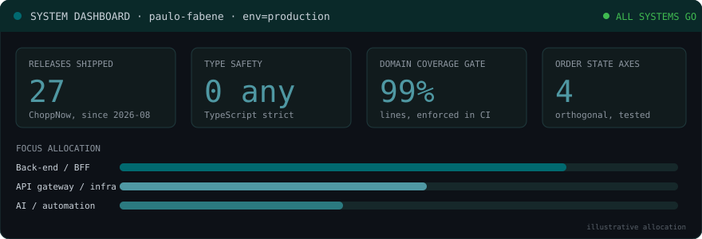

  

| | |
|---|---|
| **Document** | SPEC-001 · Engineer Profile |
| **Status** |   |
| **Owner** | Paulo Fabene |
| **Role** | Back-End Engineer: Node.js, BFF, API orchestration |
| **Education** | Systems Analysis & Development · ML Engineering |
| **Contact** | [LinkedIn](https://www.linkedin.com/in/paulofabene) · [Email](mailto:fabenejunior@hotmail.com) · [Instagram](https://instagram.com/paulofabene) · [Twitch](https://www.twitch.tv/fabenejr) |

## 1. Component matrix

| Layer | Technology | Notes |
|---|---|---|
| Languages |    | TS first |
| Runtime / frameworks |      | BFF + web |
| Data |      | |
| Edge / platform |        | gateway, observability |
| AI |   | agents, automation |

## 2. Active project

**ChoppNow**: a sales booster for draft beer events. A public storefront generates the order, and a lean console supports the supplier payout.

| Decision | Choice | Why |
|---|---|---|
| Monorepo | npm workspaces + Turborepo | one place for apps and shared packages |
| Boundaries | Ports & adapters, enforced by lint | swap infra without touching the domain |
| Order model | 4 orthogonal axes: status · payment · validation · fulfillment | no impossible states |
| Testing | Jest + contract tests · Playwright · pgTAP | same suite against real and in-memory adapters |
| Delivery | merge = staging, Release = production | production changes are deliberate |

## 3. Telemetry

  
  

  

Revision 1.0 · always learning, always shipping ✅
